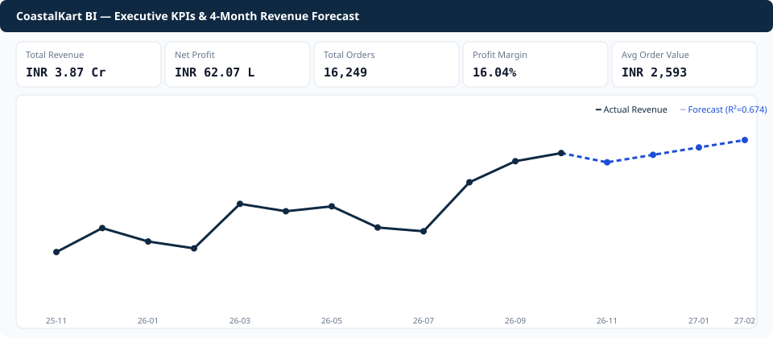
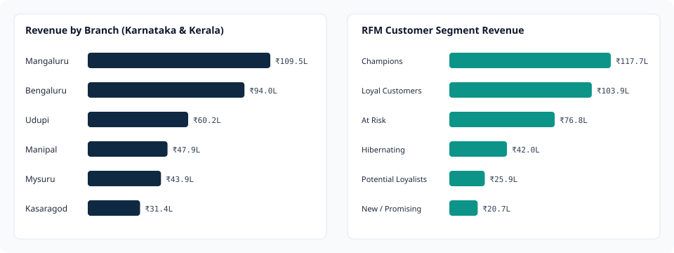
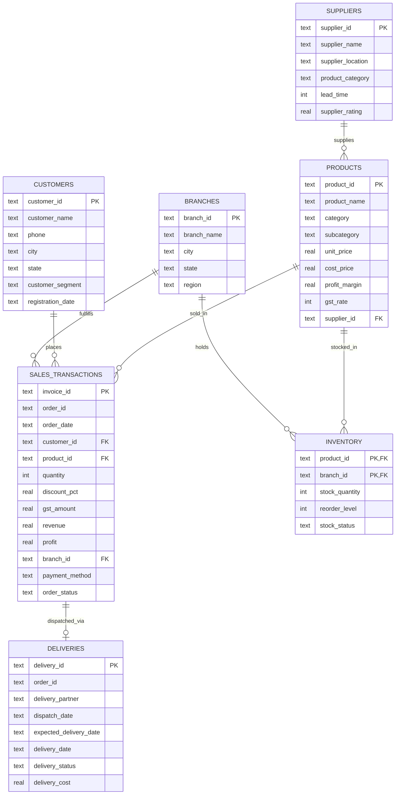

# CoastalKart — Mangaluru Retail & E-commerce Business Intelligence Platform

A complete, portfolio-grade Business Intelligence & Data Analytics platform built for **CoastalKart Retail & E-commerce Pvt. Ltd.** (a simulated omnichannel retail company headquartered in Mangaluru, Karnataka, India).

> **Disclaimer:** This is a simulated business case study created for Data Analyst and Business Intelligence portfolio demonstration. All customer names, synthetic `+91` phone numbers, invoices, and operational figures are generated programmatically.

---

## Dashboard Previews





---

## Business Problem Statement

CoastalKart operates 6 regional hubs across **Mangaluru, Udupi, Manipal, Bengaluru, Mysuru, and Kasaragod**. Despite steady top-line growth across Grocery, Household, Electronics, and Fashion categories, management faces five operational challenges:

1. **Regional Profitability Variance:** Identifying which branches drive revenue versus net margin after festive discounting.
2. **Inventory Imbalances:** Fast-moving Grocery/Household SKUs experiencing stockouts in Mangaluru & Bengaluru while slow-moving inventory accumulates in secondary depots.
3. **Interstate Delivery Delays:** High SLA breach rates on the Kasaragod (Kerala) corridor and among specific 3PL carriers.
4. **Customer Retention:** Converting one-time festive shoppers into repeat buyers using RFM scoring and Monthly Retention Cohorts.
5. **Margin Compression:** High-volume Electronics SKUs delivering `<10%` realized margin due to deep discounting.

---

## Entity-Relationship (ER) Warehouse Schema



---

## Project Architecture

```text
coastalkart-analytics/
├── app.py                              # Main Streamlit multipage application
├── requirements.txt                    # Python dependencies
├── .streamlit/config.toml              # Corporate navy/white Streamlit theme
├── .gitignore
├── assets/
│   ├── CoastalKart_Executive_Report.xlsx  # Automated 5-sheet Excel BI workbook
│   ├── executive_overview.svg          # Executive KPIs & Forecast preview
│   └── branch_and_rfm.svg              # Branch & RFM revenue preview
├── data/
│   ├── raw/                            # Raw synthetic CSVs with injected anomalies
│   └── processed/                      # Cleaned CSVs + data_quality_report.json
├── database/
│   └── coastalkart.db                  # Normalized SQLite 3 relational warehouse
├── src/
│   ├── data_generator.py               # Reproducible 12-month dataset (seed=42)
│   ├── data_cleaning.py                # Anomaly detection, deduplication & validation
│   ├── database.py                     # SQLite schema, FK constraints & query runner
│   ├── metrics.py                      # KPIs, RFM, Monthly Cohorts & Supplier Scorecard
│   ├── forecasting.py                  # OLS linear trend + 3M moving average forecast
│   ├── insights.py                     # Dynamic SQL-driven management recommendations
│   ├── excel_exporter.py               # Multi-sheet openpyxl Excel report generator
│   ├── export_utils.py                 # Streamlit CSV, Excel (.xlsx), and PDF export helpers
│   └── generate_assets.py              # SVG dashboard preview generator
├── sql/
│   ├── sales_analysis.sql              # 6 Sales & Margin SQL queries (CTEs, LAG, DENSE_RANK)
│   ├── customer_analysis.sql           # 6 Customer & RFM SQL queries (NTILE, Cohorts)
│   ├── inventory_analysis.sql          # 5 Stock Health & Supplier SQL queries
│   └── logistics_analysis.sql          # 5 Delivery Partner & Corridor SLA SQL queries
├── pages/                              # 9 modular Streamlit BI pages
└── tests/
    ├── test_metrics.py                 # KPI, RFM, Forecasting & Insights unit tests
    ├── test_data_quality.py            # Raw vs Clean integrity & FK tests
    └── test_sql_queries.py             # Regression test executing all 22 SQL queries
```

---

## Data Dictionary (12 Months · INR ₹ · DD-MM-YYYY)

| Table | Clean Rows | Description & Key Metrics |
| --- | ---: | --- |
| `sales_transactions` | 25,000 | Invoice-level transactions (`01-11-2025` to `31-10-2026`), discounts, GST amount, net revenue, net profit, payment method (`UPI`, `Credit Card`, `Debit Card`, `COD`, `Net Banking`), order status (`Completed`, `Returned`, `Cancelled`). |
| `customers` | 5,000 | Customer demographics, synthetic `+91` phone numbers, city/state, account segment (`Retail Consumer`, `Prime Member`, `Bulk / Kirana Partner`, `Corporate Buyer`), and registration date. |
| `products` | 500 | SKU catalog across 4 categories & 17 subcategories with unit price, cost price, margin %, GST rate (`5%`, `12%`, `18%`), and linked `supplier_id`. |
| `inventory` | 3,000 | Branch-level stock positions (`500 SKUs × 6 branches`) tagged as `Out of Stock`, `Low Stock`, `Optimal`, or `Overstocked`. |
| `deliveries` | 10,800 | Shipment logistics tracking across 5 3PL partners (`CoastalExpress`, `BlueDart Regional`, `Delhivery South`, `Shadowfax Hyperlocal`, `Ecom Express`) with SLA dates and delivery costs. |
| `suppliers` | 30 | Regional vendors with location, primary product category, lead time (`2–10 days`), and supplier rating (`3.4–4.9`). |
| `branches` | 6 | Operational hubs in Mangaluru, Bengaluru, Udupi, Manipal, Mysuru, and Kasaragod. |

---

## Data Quality Pipeline

`src/data_cleaning.py` processes `data/raw/` and remediates **332** injected anomalies prior to SQLite ingestion:
- **Duplicate Invoice Removal:** Deduplicates on unique `invoice_id`.
- **Missing Value Imputation:** Imputes missing `payment_method` and customer `city` fields.
- **Quantity & Revenue Validation:** Repairs negative/zero quantities and recomputes `revenue = (qty * unit_price) - discount` and GST splits.
- **Date Validation:** Enforces `DD-MM-YYYY` formatting and ISO-8601 warehouse keys.
- **Referential Integrity:** Validates foreign keys across `customers`, `products`, `branches`, and `deliveries`.

---

## Automated Excel Reporting

Run `python src/excel_exporter.py` to generate `assets/CoastalKart_Executive_Report.xlsx` containing five formatted management tabs:
1. `Executive_KPIs`
2. `Branch_Performance`
3. `RFM_Cohorts`
4. `Reorder_Alerts`
5. `Delivery_SLA`

---

## Local Setup & Execution

```bash
# 1. Navigate to the project folder
cd coastalkart-analytics

# 2. Create virtual environment & install dependencies
python -m venv .venv
source .venv/bin/activate
pip install -r requirements.txt

# 3. Generate dataset, clean anomalies, build SQLite warehouse & Excel report
python src/data_generator.py
python src/data_cleaning.py
python src/database.py
python src/excel_exporter.py

# 4. Run all automated tests (metrics, data quality, and all 22 SQL queries)
python -m unittest discover -s tests -v

# 5. Launch the Streamlit BI platform
streamlit run app.py
```

---

## Deployment Instructions

### Option A: Streamlit Community Cloud (Free Hosting)
1. Push the `coastalkart-analytics/` folder to a public or private GitHub repository.
2. Sign in to [share.streamlit.io](https://share.streamlit.io) and click **New app**.
3. Select your repository, branch (`main`), and set the **Main file path** to `app.py`.
4. Click **Deploy**. On first boot, `app.py` automatically builds `coastalkart.db` if not present.

### Option B: Docker Container
```dockerfile
FROM python:3.10-slim
WORKDIR /app
COPY requirements.txt .
RUN pip install --no-cache-dir -r requirements.txt
COPY . .
RUN python src/data_generator.py && python src/data_cleaning.py && python src/database.py
EXPOSE 8501
CMD ["streamlit", "run", "app.py", "--server.port=8501", "--server.address=0.0.0.0"]
```

---

## Portfolio Resume Summary (Data Analyst / BI Analyst)

> **CoastalKart Retail & E-commerce BI Platform** | *Python, SQLite, SQL, Pandas, Plotly, Streamlit, Excel*
> - Engineered an end-to-end omnichannel retail BI platform simulating 12 months of operations (25,000 transactions, 5,000 customers, 500 SKUs, 10,800 deliveries) across 6 Karnataka & Kerala hubs.
> - Built a reproducible ETL & data-cleaning pipeline that detected and remediated 332 raw operational anomalies (duplicate invoices, negative quantities, malformed dates, revenue mismatches) before SQLite warehouse ingestion.
> - Authored 22+ analytical SQL queries using CTEs, `LAG`, `DENSE_RANK`, `NTILE(5)` RFM scoring, Monthly Retention Cohorts, and moving averages to identify high-volume/low-margin SKUs (`<10%`), interstate SLA bottlenecks, and working-capital stockouts.
> - Automated multi-sheet Excel executive workbooks (`openpyxl`), PDF reporting, OLS revenue forecasting, and SQL regression testing (`unittest`).
